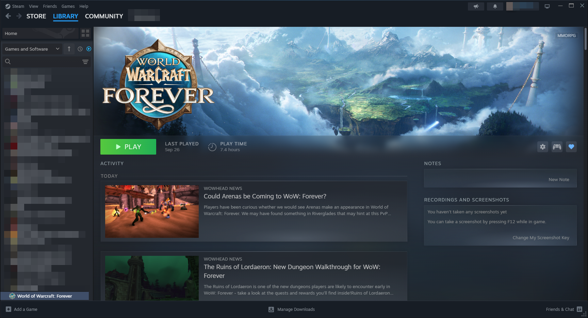
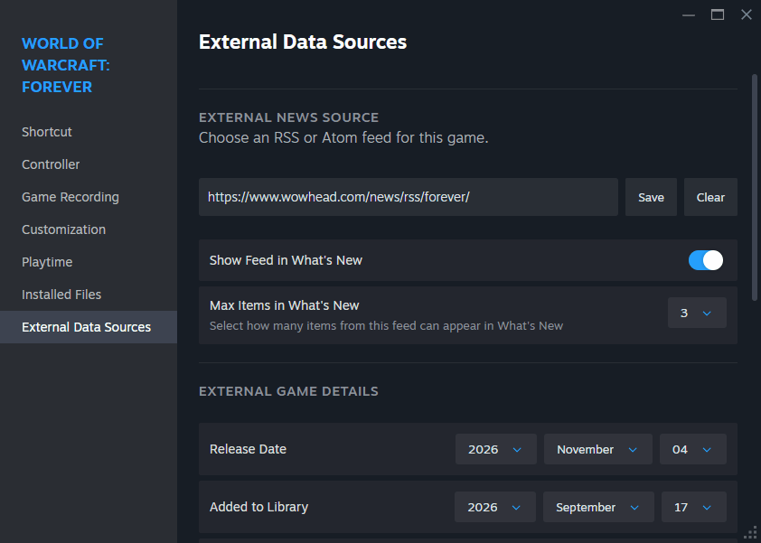

# External Data Sources Plugin for Millennium

A Millennium plugin that adds external data integration for non-Steam games:

**Add RSS/Atom newsfeeds for non-Steam games.**



Your favorite game is not on Steam. You add it as a non-Steam game. Now you are missing all the hot updates? No more! Add a blog, a fansite, official news or even a forum feed. Stay up-to-date on what is going on straight from within Steam.

And yes, of course the news items show up on "What's New" as well! Unless you do not want them to. Control whether a feed shows up in "What's New" and how many entries are being displayed. Choose between a modest number - or let a single feed take over the entire section.

**Set release date, added to library data, developer/publisher for non-Steam games and add Steam store tags to non-Steam games.**



Your non-Steam games always sit at the end of your release date or added to library date sorting. Set exactly when a game came out and at what date you added it to your library.

Of course, there is more to life than just sorting; filtering is just as important. Add Steam store tags as well as pseudo-tags to your non-Steam games, so dynamic collections automatically pick up the games and filtering by store tags, genre or players will yield the expected results. The perfect tag does not exist on Steam? Just add whatever local pseudo-tag you want! Pseudo-tags only exist on your local client.

**Works in both Desktop and Big Picture mode.**

No matter whether you are sitting in your chair or on the couch - the External Data Sources plugin supports both modes.

*<u>Note:</u> Desktop mode is the primary target for this plugin!*


## Data storage and Steam services

Plugin settings and game metadata are saved in Millennium's local configuration.
The plugin reads Steam data and adds metadata and news to in-memory library views;
it does not upload these overrides or synthetic news events to Steam.
Feed downloads use HTTP GET requests to the configured source.

Custom tags work in local Library Filters. Saving a collection containing custom
tag IDs to Steam Cloud is blocked, and those IDs are excluded from Store search
links. Steam's normal actions on native games and collections remain available.

In other words: your settings and metadata stay on your machine. The only network traffic is fetching the feeds you configure and loading the images they reference.


## How to Install

1. Go to the [Releases page](../../releases/latest) and download the latest `io.tsukasa.external-data-sources.star` file.
2. Place the `.star` file in your Millennium plugin folder.
3. Open your Millennium settings and confirm that **External Data Sources** is listed and enabled.


## How to Use


### Feeds

To configure a newsfeed for a non-Steam game, do the following:
1. Right-click a non-Steam game and select **Properties** → **External Data Sources**.
2. Enter a fully qualified HTTP or HTTPS URL for an RSS 2.0 or Atom 1.0 feed.
3. The URL saves automatically once you stop typing or leave the field, and the news view refreshes.
4. Empty the field (or use its clear button) to remove the source and restore Steam's default behavior.

Note: You can save exactly one feed per shortcut AppID.

When displaying feed items, the plugin automatically tries to select an image from the feed.

If an item has no image, the plugin uses the game's hero artwork when available. Items without dates appear at the end of the list.

Clicking an article opens it in your default browser or Big Picture's integrated browser.

If a feed refresh fails, the last successful feed items remain visible. The plugin retries on the next background refresh for that feed.

Successfully retrieved feeds are cached for ten minutes by default. In Millennium's plugin settings, you can set a global refresh interval of 10 to 360 minutes and the number of simultaneous background feed fetches (1 to 8). Changing a feed source invalidates its cache.


### Game Data

To configure game data, do the following:

1. Right-click a non-Steam game and select **Properties** → **External Data Sources**.
2. Scroll down to the **External Game Data** section.
3. Set a release date or remove it by setting one field to "--".
4. Add a developer or publisher by entering the name and pressing Enter.
5. Add Steam store tags by typing a search term and selecting matching tags.
6. For pseudo-tags you can simply enter a tag name and press enter.
7. To remove a tag, click the "x" in its chip.

The date fields have an impact on specific sorting-order modes of the library. If no date is set, Steam's default behavior takes precendence.

Adding appropriate tags to a non-Steam game allows the game to appear in Steam's library filtering as well as dynamic collections.


### Configuration Storage

Per-game feed settings are stored in Millennium's persistent plugin configuration
under `plugins["io.tsukasa.external-data-sources"].config["<appid>"].feed` in the Millennium `config.json`.

Removing a non-Steam shortcut from the Steam library also removes its configured feed and release date.


## How to Build

To build this plugin, you will require Bun and Node.js:

```sh
bun install --frozen-lockfile
bun run check
bun run test
bun run build
```

Backend regression tests can also be run from the repository root with Lua 5.4:

```sh
lua tests/backend.test.lua
```

Translations are maintained in `resources/locales/<steam-language>.json`.

The build, type-check, test, and development commands generate `resources/locales.json`
for the frontend. While `bun run dev` is running, run `bun run locales` after editing
a language file to refresh the bundle.

Building with `bun run build` packages the plugin as a `.star` file into the `dist` folder.

To install the plugin, copy the `.star` file to your Millennium plugin folder and enable
**External Data Sources** in Millennium.


## Acknowledgements

The following projects were a great inspiration:
- [retrotoolsdev-wq's Game Data Linker](https://github.com/retrotoolsdev-wq/game-data-linker/) for the idea of fetching external data.
- [k0d13's Steam non-Steam Playtimes](https://github.com/k0d13/steam-non-steam-playtimes/) for the initial code to generate and hook a property page.
- Uses [Millennium's PluginTemplate](https://github.com/SteamClientHomebrew/PluginTemplate) as a base for the plugin.
- This project is AI slop. A good chunk of the frontend code was either generated, reviewed or altered with AI tools.
- The generation and translation of the non-English locales were performed with AI tools as well.

Detailed acknowledgements are included in [THIRD_PARTY_NOTICES.md](THIRD_PARTY_NOTICES.md) within the `.star` file.


## FAQ

**Q: Why is this plugin not available on Millennium's plugin page?**

I built this for my own use. Maintaining a plugin on an officially curated list would be
more commitment than I want to take on. Feel free to fork this code, improve it, and
submit it to Millennium. That's what open source is for.

**Q: Why did you use a clanker? The code sucks!**

As long as desktop applications continue to use web technologies, I have very little shame in generating parts I cannot be bothered to work out myself. It is already a shit stack anyway.

The clanker is really good at drilling into a React application's structure. This vastly accelerates the development process.
